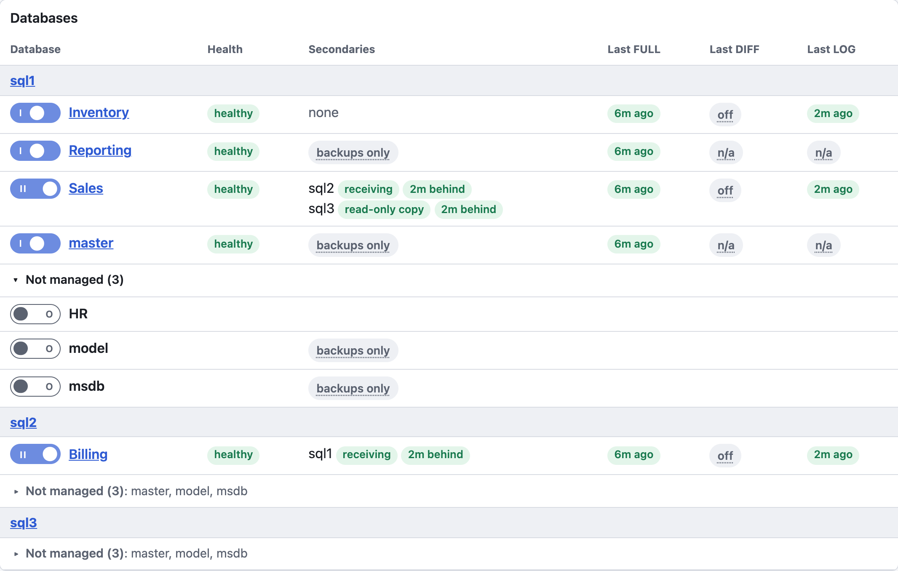
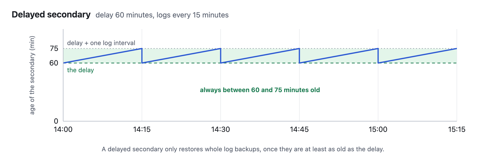
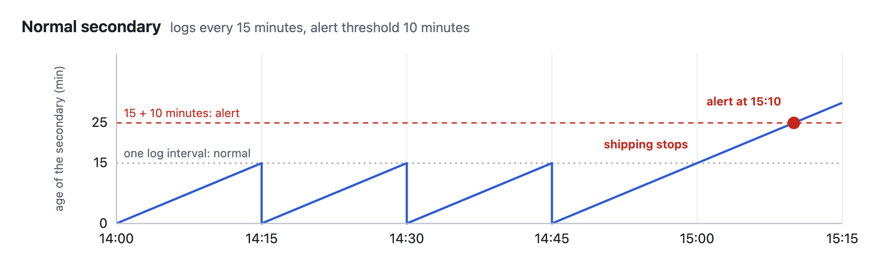
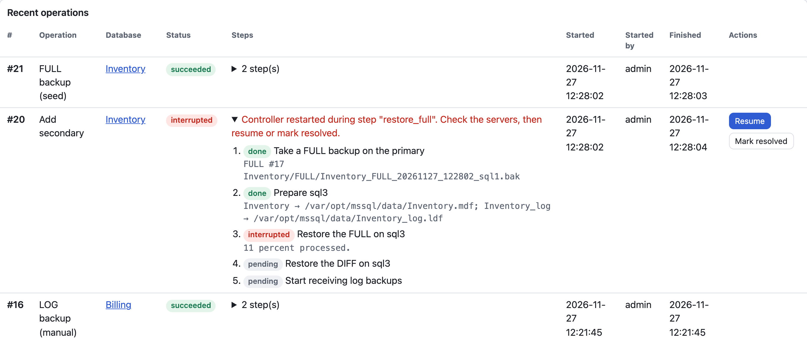
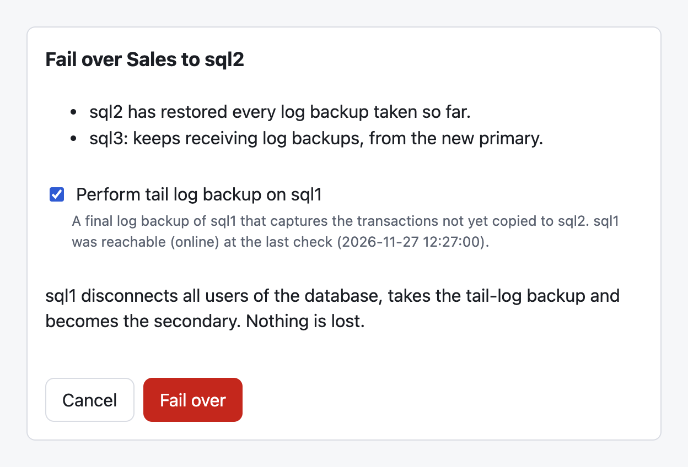
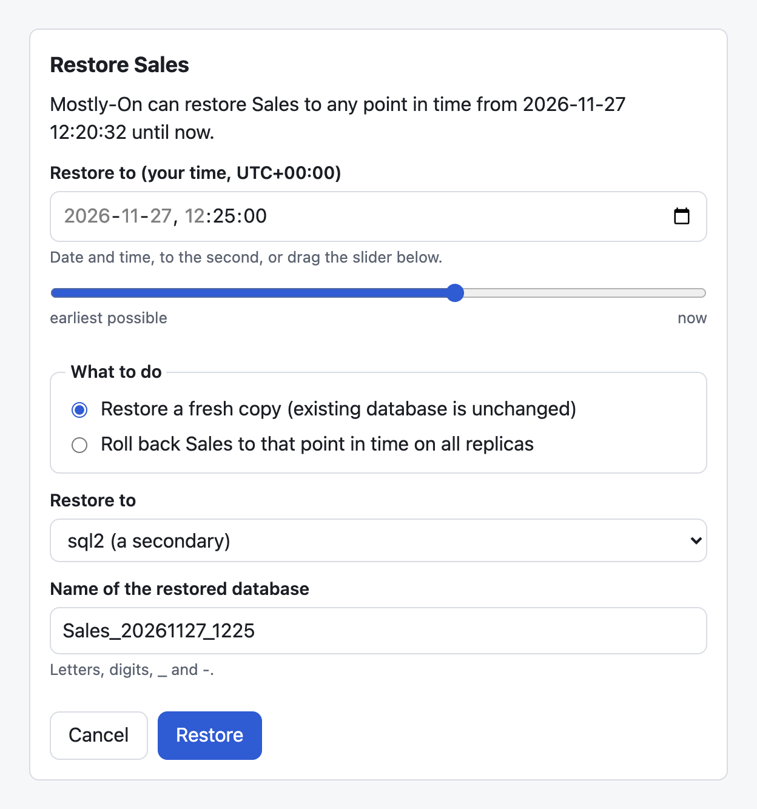

# Mostly-On

SQL Server backup and log shipping for people who don't have SQL Server Agent or just don't have the patience for shell scripts and cron jobs.


SQL Server Express Edition has no SQL Server Agent, and for anything less than Enterprise Edition, you won't have any kind of out-of-the-box high availability. Mostly-On is a small orchestrator, running in its own container, that takes care of:

- **Backing up** your databases on a schedule (FULL, DIFF and LOG), with checksums, to a shared backup folder. That includes the system databases (master, model, msdb) and databases in SIMPLE recovery, so one tool covers every database.
- **Log shipping** to one or more secondary servers, keeping an up-to-date copy of the database.
- **Failing over** your databases to a secondary replica if the primary server needs maintenance or has failed, directly from the dashboard.
- **Alerting** (using [Pushover](https://pushover.net/)) when a managed server goes down or something needs your attention.

> [!IMPORTANT]
> Mostly-On is *not* a high-availability (HA) solution, for multiple reasons.
> It can help serve as a disaster recovery (DR) mechanism in some respects.

- **No automatic failover.** You have to perform the failover yourself.
- **No login or job sync.** Server-level objects (logins, linked servers, ...) are not automatically synchronized.
- **No client redirection.** After a failover, you need to point direct your applications at the new primary (changing the connection string, DNS alias or virtual IP).
- **No high availability for the orchestrator itself.** If the Mostly-On container is down, nothing is backed up or shipped until it is back. It is built to restart safely, though. You need to make sure your container restarts automatically.

> [!WARNING]
> This project was largely vibe-coded and is in early beta. Please test it properly
> before deploying to important or sensitive environments.

Contents: [Quick start demo](#quick-start-trying-it-out-in-a-sandbox) · [Deploying](#deploying) · [The shared backup folder](#the-shared-backup-folder) · [Configuration](#configuration) · [SQL Server requirements](#sql-server-requirements) · [How it works](#how-it-works) · [Failover, step by step](#failover-step-by-step) · [Upgrading](#upgrading-mostly-on) · [Development and tests](#development-and-tests) · [Known limitations](#known-limitations) · [License](#license)

---

## Quick start (trying it out in a sandbox)

Mostly-On is published as a container image, `ghcr.io/strdco/mostly-on`. The demo starts it together with three SQL Server Express containers (`sql1`, `sql2`, `sql3`) and a shared backup volume. You need `docker-compose.yml`, `docker-compose.demo.yml`, `.env.example` and the `sql` folder from this repository; cloning it is easiest.

- [ ] Create your settings file:

   ```sh
   cp .env.example .env
   ```

- [ ] Generate a password hash for your admin account:

     ```sh
     docker run --rm -it ghcr.io/strdco/mostly-on:latest node scripts/hash-password.js
     ```

- [ ] Fill in the four required values in `.env`:

   - `ADMIN_PASSWORD_HASH`: the hashed password you just generated. Once the Mostly-On container is up and running, you add users in the interface.
   - `SECRET_KEY`: 32 random bytes, base64. `openssl rand -base64 32` or `npm run gen-secret`.
   - `MSSQL_SA_PASSWORD`: the `sa` password for the demo SQL Servers (at least 8 characters, with three of: upper case, lower case, digits, symbols).
   - `MOSTLY_ON_SQL_PASSWORD`: the password of `mostly_on`, the restricted login Mostly-On uses on the demo servers (same rules). The demo's one-shot `sql-setup` service creates that login and runs the setup script on all three servers; see [SQL Server requirements](#sql-server-requirements).

- [ ] Start everything, and wait for all the services to come online:

   ```sh
   docker compose -f docker-compose.yml -f docker-compose.demo.yml up -d
   ```

- [ ] Open <http://localhost:8080> and sign in as `admin`.
- [ ] On the **Servers** page, register your SQL Servers:

   | Field | Value |
   |---|---|
   | Name / Host | `sql1`, `sql2` or `sql3` |
   | SQL login | `mostly_on` |
   | SQL password | your `MOSTLY_ON_SQL_PASSWORD` |
   | Shared backup folder, as this SQL Server sees it | `/var/opt/mssql/backup` |

- [ ] Connect to one of the SQL Server containers with SSMS or your tool of choice (localhost, ports 14331, 14332 or 14333) and create a database. It will appear on the **Overview** page, under your server's **Not managed** list.
- [ ] Click the database's on/off toggle switch, and follow the on-screen instructions to manage the database. This starts the process of backing up the database.
- [ ] Click on the database in the overview list, then on **Add secondary** and select a secondary server to start the log shipping.

   The icon next to the database shows how Mostly-On manages the database: **O** not managed, **I** managed without secondaries (only backed up), **II** log-shipped to one or more secondaries. To stop managing a database, press the toggle switch. System databases (master, model, msdb) and databases in SIMPLE or BULK_LOGGED recovery can be managed, too, but they are tagged **backups only** because they cannot be log-shipped (see [How it works](#how-it-works)).

   

- [ ] You can fail over a database to it's secondary replica by clicking on the database, and then the **Failover** button for one of its secondary replicas. This makes the secondary the new primary, and the former primary becomes a secondary.

---

## Deploying

A production setup has three parts:

1. **Your SQL Server instances**, version 2019 or newer: on Linux or Windows, in containers or installed.
2. **A shared backup folder** on a file server or NAS (NFS or SMB), which every SQL Server and Mostly-On can read and write.
3. **The Mostly-On container**, on a Linux machine. On a Windows-only site, a small Linux VM (Hyper-V, for example) does the job.

The setup guides walk you through it, one checklist at a time:

- [ ] Start with [Setting up the Mostly-On container](setup/mostly-on-container.md). It also prepares the backup share.
- [ ] Then set up each SQL Server with the guide that matches how it runs. You can mix them: a Windows primary with a Linux secondary works.
  - [SQL Server containers on Linux](setup/sql-containers-on-linux.md)
  - [SQL Server on Linux](setup/sql-on-linux.md) (installed, not in a container)
  - [SQL Server on Windows](setup/sql-on-windows.md) (installed)

> [!IMPORTANT]
> Using container volumes is critical to persisting Mostly-On's metadata and catalog.
> If you don't use persistent volumes, all this data will be lost when you update the
> Docker image.

The catalog in `/data` holds the history and the intent ("which server should be the primary"). SQL Server itself remains the source of truth for the state of each database. Back up `/data` like any other application data.

---

## The shared backup folder

In order to be able to ship logs and fail over from one server to another, all participating servers in a replica set write their backups into **one** folder, and every secondary restores from it. Mostly-On organises it like this:

```
<backup root>/<database>/FULL/<database>_FULL_<yyyyMMdd_HHmmss>_<server>.bak
<backup root>/<database>/DIFF/<database>_DIFF_<yyyyMMdd_HHmmss>_<server>.bak
<backup root>/<database>/LOG/<database>_LOG_<yyyyMMdd_HHmmss>_<server>.trn
<backup root>/<database>/DIVERGED/...   (safety backups of out-of-sync copies; never deleted automatically)
<backup root>/<database>@<server>/... (FULL, DIFF and LOG for databases backed up but not log-shipped)
```

A log-shipped database has one folder, whichever server is its primary. A **backups-only** database (a system database, or one not in FULL recovery) belongs to one server, so its folder carries that server's name: every server has its own `master`, for example `master@sql1` and `master@sql2`.


**The folder can have a different path on each machine.** When you register a server, you tell Mostly-On where the folder is *as that SQL Server sees it*. This is important when your database server runs in a container where, for example, `/var/opt/mssql/backup` might map to an SMB share. If the controller has it somewhere other than what you've configured as `BACKUP_ROOT`, set that path on the server too.

**Who needs access.** Everything that uses the folder must be able to create folders and files in it, and to read and delete what the others wrote:

- **SQL Server** writes the backups, and reads them when it restores. In a container, it runs as user ID 10001.
- **Mostly-On** creates a folder for each database, and deletes backups once they have expired. It runs as user ID 10001, group 0.

When that isn't the case, backups fail with *Operating system error 5 (Access is denied)*, or Mostly-On logs that it could not delete old backup files.

To set it up, NFS or SMB, follow the [setup guides](#deploying).

---

## Configuration

Everything is set through environment variables (see `.env.example`). Everything else is set in the dashboard under **Settings**.

| Variable | Required | Default | What it is |
|---|---|---|---|
| `ADMIN_PASSWORD_HASH` | first start | | Hash of the first user's password (`npm run hash-password`). Only used while there are no users yet; after that, users are managed on the **Users** page and it is ignored. |
| `SECRET_KEY` | yes | | 32 random bytes, base64. Encrypts the SQL Server passwords in the catalog. If you lose it, you have to re-enter every server password. |
| `ADMIN_USER` | | `admin` | The first user's name (see `ADMIN_PASSWORD_HASH`). |
| `PUBLIC_URL` | | `http://localhost:8080` | The address people use to reach the dashboard. Used for the cross-site request check and for links in notifications. |
| `COOKIE_SECURE` | | on for `https://` | Mark the login cookie Secure. |
| `SESSION_TTL_HOURS` | | `12` | How long a login lasts. |
| `TZ` | | `UTC` | Time zone for schedule times such as "daily at 01:30". |
| `LOG_LEVEL` | | `info` | `debug`, `info`, `warn` or `error`. Logs are JSON lines on stdout. |
| `PUSHOVER_APP_TOKEN`, `PUSHOVER_USER_KEY` | | | Turn on Pushover notifications. Without them, alerts only show in the dashboard. |
| `PUSHOVER_API_URL` | | Pushover's API | Only for testing against a mock. |
| `PORT`, `DATA_DIR`, `BACKUP_ROOT` | | `8080`, `/data`, `/backup` | Container paths and port; rarely changed. |
| `MSSQL_SA_PASSWORD` | demo only | | `sa` password for the demo SQL Server containers. |
| `MOSTLY_ON_SQL_PASSWORD` | demo only | | Password of the restricted `mostly_on` login the demo creates on its SQL Servers. |

---

## SQL Server requirements

- **SQL Server 2019 or newer.** All editions, including Express Edition, will work.
- Databases you ship must use **FULL recovery model**. To switch model: `ALTER DATABASE [name] SET RECOVERY FULL;` A shipped database switched to SIMPLE or BULK_LOGGED later gets no log backups until it is back in FULL, and Mostly-On alerts you. Databases in SIMPLE or BULK_LOGGED recovery, and the system databases, can still be backed up (**backups only**, see [How it works](#how-it-works)).
- **Each server needs Mostly-On's setup script, run once by a sysadmin.** Mostly-On's own login should *not* have sysadmin privileges (see below).
- Secondaries need to have the same major version or higher as the primary.
- Readable secondaries ("STANDBY") need the same major SQL Server version as the primary.

> [!IMPORTANT]
> Nothing else may take log backups of a managed database. A log backup taken by another tool (like a maintenance plan or a backup agent) holds changes that the secondaries will never receive, which breaks the so-called "log chain".
> Mostly-On detects this and alerts you.
> Backups taken with `COPY_ONLY` are always safe and do not break the log chain.

### The setup script, and why Mostly-On does not need sysadmin

Backing up, restoring, failing over and disconnecting users all need high privileges. One of them can't even be granted server-wide: SQL Server only allows BACKUP per database. Instead of granting Mostly-On a sysadmin login, a sysadmin runs a **setup script** on each server:

- It installs a few **stored procedures in `master`** (in the `mostly_on` schema) that perform Mostly-On's work.
- It **signs** these procedures with a certificate. The rights come from that signature (`CONTROL SERVER` and `dbcreator`), and only while one of those procedures runs. The certificate's private key is deleted after signing, so nothing else can ever be signed with it.
- It gives Mostly-On's login only:
  - permission to **run** those procedures;
  - **read** access to server state and backup history (`VIEW SERVER STATE`, `VIEW ANY DEFINITION`, db_datareader in `msdb`).

What that means in practice:

- **Mostly-On's login on its own can do almost nothing.** It cannot read your data, create logins, change server settings, or back up and restore anything directly. (The backup files hold all your data, so protect the shared backup folder too! Backups of `master` and `msdb` also hold the server's logins with their password hashes, its credentials and its jobs.)
- **The procedures have guard rails.** They back up the system databases master, model and msdb, but never restore or change them, and never touch tempdb. They only read or write backup files inside the shared backup folder. They drop a database only when nobody can write to it (`RESTORING`, or a read-only `STANDBY` copy): a secondary you remove, or the copy of a database that was dropped on its primary. Restored database files only go to the server's default data and log folders. They never make Mostly-On's login the owner of a database, so they can't be used to read your data either.
- **They can still do what failover needs.** That includes overwriting a database and taking one offline, which is the job itself. The procedures accept **every user database on the server**, not only the ones Mostly-On manages. Whoever controls Mostly-On (its dashboard, or its SQL login) can therefore disrupt any user database on the server; protect both accordingly.
- **Database owners are kept.** A restored database would otherwise belong to Mostly-On's login. When a copy is brought online at failover, it gets its original owner back if that login exists on the server: matched by SID first, then by name. If neither exists, it gets `sa`, and an event tells you how to fix it; a later failover to that server gives it back to its owner once the login exists. Any other database (one that Mostly-On didn't restore or hand to `sa` itself) always keeps its owner.

Each [setup guide](#deploying) ends with the same steps: create a login for Mostly-On, register the server, then download its setup script on the server's page (under **Setup**) and run it as a sysadmin. Running it again is always safe.

The **Servers** page shows whether each server is ready. A new version of Mostly-On may need a newer script, and so does changing a server's backup folder or undo-file folder in Mostly-On (the helper procedures only use the folders the script was run with). The page (and an alert) will tell you, and backups and failovers on that server will wait until you have run it again. The template is [`sql/mostly-on-helpers.sql`](sql/mostly-on-helpers.sql); review it before you run it.

---

## How it works

- **Backups.** Each managed database has a FULL, DIFF and LOG schedule. They follow the default schedules under Settings, unless you create a custom schedule on the database's page. DIFF backups can speed up point-in-time restores for large databases and are disabled by default.

> [!IMPORTANT]
> Backups are not compressed, in order to maintain compatibility with SQL Server Express Edition.

- At most **2 backup/restore operations run at a time** on each SQL Server. Change this default under Settings (**SQL Servers connections**), or give a server a custom value (server, **More options**).
  - Health checks and other short queries have their own connections and never wait, so a busy server is never reported unreachable.
  - Failovers and rollbacks never wait. A scheduled backup or a restore that is still waiting when a failover or rollback needs its database gives way, and runs again later.
- **Shipping.** After every log backup, each secondary restores it (`WITH NORECOVERY`, or `STANDBY` for a readable copy). Readers of a readable copy are forcibly disconnected when a restore happens. The "behind" number on the dashboard shows how far the replica has been restored.
- **Backups only.** The system databases (master, model, msdb) as well as user databases not in FULL recovery model, are backed up on their own server only, in the folder `<database>@<server>`. They are tagged **backups only** on the dashboard and only get FULL backups.
  - Backup-only databases cannot have secondaries, cannot failover.
  - Mostly-On cannot restore system databaes.
  - Retention works the same as for any other database.
  - A user database switched to FULL recovery later gets LOG backups by itself. To log ship it, stop managing it, then manage it again.
  - Backups another tool takes of them are noted on the database's page, so you can tell if an old backup job is still running.
- **Stopped shipping.** If a log backup is missing, or if the secondary cannot restore it, Mostly-On stops shipping to that replica and tells you why. Press **Try again**, or **Reinitialize** the secondary completely.
- **Removing a secondary** stops shipping to and asks what to do with the old secondary: drop it (default), bring it online as a stand-alone database, or leave it in the restoring state.
- **Delayed secondaries.** A secondary replica can be kept behind on purpose, so you can compare older data when troubleshooting production issues. This delay is configured in minutes.
  - A delayed secondary only restores entire log backups, so the replica will end up *at least* as old as the configured delay.
  - You cannot fail over to a delayed secondary.
  - Only a readable (STANDBY) copy can be queried. Readers are forcibly disconnected at every restore. To prevent this, press **Pause sync**.

  
- **Retention.** Old backup files are deleted after the number of days you define (Settings), per backup type; a database can have its own, overriding, values. Files required by a secondary are always kept even after the retention period. Backups from dropped databases are subject to the same retention policies. A database you stop managing yourself keeps its files until you delete them.
- FULL backups are always kept at least as long as DIFF and LOG backups, as those would be useless without the FULL they build on; Mostly-On will refuse settings that would break this rule.
- **Alerts.** Mostly-On alerts you once when a problem starts, then reminds you every few hours while it lasts, and sends one notice when it is resolved. Alerts cover:
  - a server is unreachable;
  - a database is not in the state it should be (not while a database on a server with automatic management is gone: that is a drop, most likely, and an event says so);
  - a log-shipped database was switched out of FULL recovery, so it gets no log backups. In SIMPLE recovery this is an error: its log chain is broken, and its secondaries need reinitializing once it is back in FULL. In BULK_LOGGED it is a warning: back in FULL, shipping catches up by itself;
  - shipping has stopped, or a secondary is too far behind. You can configure alert thresholds on the **Settings** page. For example, with logs every 15 minutes and an alert threshold of 10 minutes, it alerts once a secondary is more than 25 minutes old;
  - a backup or restore failed;
  - a backup was taken outside Mostly-On;
  - an old primary is out of sync, or is accepting writes (split brain);
  - a failover or other operation failed.

  

  Alert state survives restarts, so nothing is sent twice.
- **Crash safety.** Every multi-step job (failovers, adding or reinitializing a secondary) is recorded step by step. After a restart, an interrupted job is never continued on its own: the **Operations** page shows exactly where it stopped, what to check, and offers **Resume** or **Mark resolved**.

  

## Automatic management

On servers where databases are more frequently created and dropped, **Manage databases automatically** will automatically manage new databases and log-ship them to a secondary. The **Servers** list shows which servers have automatic management turned on, and where they ship new databases.

- **New databases are managed by themselves.** A user database is managed a minute after it appears, so an application has time to set it up (switch it to FULL recovery, for example). Turning it on also manages the user databases already on the server that Mostly-On does not manage yet; the dialog lists them first.
- **Databases are log-shipped to the server you choose.** A database in FULL recovery gets a secondary once its first FULL backup has completed. Databases not in FULL recovery are backed up only.
- **Servers are paired.** Configuring sql1 to automatically ship to sql2 will also set sql2 to ship back to sql1. This is relevant in case of a failover, in which case the primary and secondary roles will reverse.
- **Dropped databases stop being managed.** A managed database that has been gone from its server for 30 minutes (Settings, **Monitoring**) is no longer managed. Backups are kept until the retention policy removes them. A database dropped and created again under the same name counts as a new database.
- **What it leaves untouched:** System databases, a database with the name of a log-shipped database on another server (a log-shipped name is taken on every server), and databases you stopped managing yourself (until you manage them again). Databases you manage by hand never get a secondary automatically.

---

## Failover, step by step

Click the **Failover** button on a secondary replica of the database. The dialog shows how many log backups the secondary still needs and asks if you want to **perform tail log backup**.



> [!WARNING]
> Failing over a database *without* a tail-log backup loses all changes made to the primary after the most recently transaction log backup was taken.
> If you still have a functioning primary database, always take a tail-log backup when failing over.


### With a tail-log backup (no data lost)

Use this when the primary is up. The box is ticked by default if it was reachable at the last check.

1. Waits for running backups and restores of this database to finish.
2. Checks both servers.
3. Restores every log backup the secondary does not have yet.
4. On the old primary, disconnects all users (sets `SINGLE_USER`) and takes a **tail-log backup**: a final log backup that captures every transaction not yet copied, and leaves the old primary waiting to become a secondary.
5. Restores the tail-log backup on the target replica.
6. Brings the target database online (`RESTORE ... WITH RECOVERY`) and lets users back in (`MULTI_USER`).
7. Swaps the roles: the target is the new primary; the old primary is now its secondary.
8. Takes the first log backup on the new primary.

If a step fails, the job stops there and the Operations page says what state each server is in, with the exact SQL to run if you want to go back.

After a failover, the primary and secondary roles are reversed, and backups are now taken from the new primary replica.

### Without a tail-log backup (data may be lost)

Use this when the primary is down or damaged. Transactions committed on the old primary after the most recently shipped log backup are lost, and the dialog shows you since when.

1. Checks the target.
2. If the old primary can be reached, takes its database **offline**, so no application can write to it. If you left the box ticked while the primary is unhealthy, Mostly-On instead tries a best-effort tail-log backup.
3. Restores every remaining log backup available on the secondary.
4. Brings the database online on the secondary.
5. Marks the old primary's copy **out of sync**, as it may hold transactions that the new primary never received. Mostly-On never restores onto it or backs it up.
6. Checks that the other secondaries can follow the new primary; those that cannot are marked for reinitializing.
7. Takes the first log backup on the new primary.

If the old primary comes back, use **Take offline** in case applications might still write to it, then **Reinitialize** it. A safety backup of the out-of-sync copy is kept first in the `DIVERGED/` folder, so no data is thrown away without a copy.

### Fail over databases from a server

For server maintenance, you can fail over all log-shipped databases by clicking **Fail over databases…** on that server's page and pick which server to move them to. The list only offers servers that hold a working secondary for at least one of the databases.

- Every database with a working secondary on the chosen server moves, one at a time, each with a tail-log backup so nothing is lost. The old server becomes the secondary.
- The dialog lists the databases that stay behind and why.
- If the chosen server runs a newer SQL Server version, the old server cannot receive its log backups afterwards; the dialog warns about this per database.
- If one failover is unsuccessful, the rest will wait; you can resume the batch when the problem is fixed.

## Restoring to a point in time

Someone deleted the wrong rows at 14:03? On the database's page, press **Restore…**, pick the date and time (type it to the second, in your browser's time zone, or drag the slider across the restorable range) and choose what to do. The dialog shows the points-in-time you can restore to, depending on the recovery model and what backups are available.



### Restore a copy (safe)

Restores the database as it was at that moment as a fresh copy, under a **new name** (for example `Sales_20261121_1403`), on any registered server. The original database is unchanged. Good if you need to look at an old snapshot of the database, then copy data you need back into the live database.

Mostly-On does not back up or manage the copy. Drop it when you are done (`DROP DATABASE [Sales_20261121_1403];`).

### Roll back the database (destructive)

Puts the managed database itself back to that moment, on the primary and on every secondary. **Every change made after this point-in-time disappears from the database.**

The tail-log backup and the other backups from after the point-in-time stay on the file share until retention deletes them. However, the dashboard will only offer point-in-times on the database's *current* branch, so there's no managed way to undo a rollback. **If you might need any of the changes made after the point-in-time, first restore a copy as it is now, then roll it back.**


### Removing a server

Click the **Remove** button on a server to stop managing it.

A removed server is no longer contacted or listed, and nothing on the SQL Server itself is changed. The backups it took stay usable until retention deletes them. Registering a server under the same name later brings its record back, with the new connection details.

---

## Users and auditing changes

Give everyone who works with Mostly-On an account of their own (**Users** page), so you can tell who did what. Every user can do everything, including adding users, setting their passwords and disabling them. A user whose password someone else chose (a new account, or **Set password**) has to choose their own at the next sign-in. Accounts are disabled, never deleted, so their names keep meaning something in the log.

The first user comes from `ADMIN_USER` and `ADMIN_PASSWORD_HASH` in the `.env` file when Mostly-On starts with an empty catalog. If nobody can sign in any more (say the only other user left, and you forgot your password), you can set a new password from the command line. It enables the account again, and its user chooses their own password at the next sign-in:

```sh
docker compose exec controller npm run reset-password -- <user>   # without a user name: lists the users
```

**Who did what** is recorded in three places:

- **Events page.** Tick **Only what people did** to see filter only human-initiated actions: failovers, rollbacks, secondaries added and removed, settings and schedules changed, sign-ins, user changes, and so on.
- **The container's log** (stdout, JSON lines). Each event is one line, with an `actor` field when a user did it. Docker's log drivers, and tools such as Loki, Datadog, Splunk or Elastic, can collect logs from there.
- **The SQL Server error log** of each server holds records of key actions: failovers, switch-overs, rollbacks and copies to a point in time, and a few others. The lines start with `Mostly-On:` and say who did it, for example `Mostly-On: Failover of Sales from SQL1 to SQL2 started (with a tail-log backup: no data loss) (by alice, operation #42)`. On Windows they also land in the Application event log, where monitoring tools can pick them up. This is a best-effort copy: a server that is down at that moment (like a failed server in a forced failover) doesn't get the line, and SQL Server recycles its error log at every restart (6 old files by default).

To find the lines on a server:

```sql
EXECUTE sys.xp_readerrorlog 0, 1, N'Mostly-On';
```

---

## Upgrading Mostly-On

Pull the new image and restart the container:

```sh
docker compose pull && docker compose up -d
```

The image `ghcr.io/strdco/mostly-on` has these tags:

| Tag | What it is |
|---|---|
| `latest` | The newest release. |
| `0.2`, `0.2.1`, ... | A specific release. Pin `0.2` to get fixes for 0.2 without moving to 0.3 by surprise. |
| `edge` | Every change on `main`, pre-release. For trying things out, not for production. |

Read the release notes before you upgrade.

> [!IMPORTANT]
> When upgrading Mostly-On, verify in the app if you need to upgrade the helper code on your SQL Servers
> to a newer version.

Some version upgrades of Mostly-On will require newer helper procedures on each server. An alert will tell you if this is the case after you've restarted the container. Until the helper code has been updated, Mostly-On cannot backup or restore on that server, and log-shipping will not work.

The catalog in `/data` upgrades itself on start:

- **Backup first.** Before the first change, Mostly-On saves a copy: `mostly-on.db.v001.bak`, named after the version it was at.
- **Downgrades are refused.** An older image refuses to start against a catalog that a newer image has already upgraded. It exits with code 3 and says so in the log.
- **Rolling back.** Stop the container, replace `mostly-on.db` with the `.bak` copy from before the upgrade, and start the old image.

For developers writing a migration (`src/store/migrations/NNN_name.sql`):

- Don't put `BEGIN`/`COMMIT` or `PRAGMA foreign_keys` in the file; the runner wraps each migration in a transaction with foreign keys off.
- To change a constraint, use SQLite's usual table rebuild: create the new table, copy the rows, drop the old one, rename.
- The foreign-key check must come back clean before a migration commits.

---

## Development and tests

```sh
npm install
npm run dev               # runs the controller locally with .env, restarting on changes
npm test                  # unit tests (no Docker needed)
npm run test:integration  # the whole scenario against real SQL Server containers
```

To run the demo stack with the controller built from your working copy instead of the published image, add `docker-compose.test.yml` (it also points notifications at a mock Pushover):

```sh
docker compose -f docker-compose.yml -f docker-compose.demo.yml -f docker-compose.test.yml up -d --build
```

The integration suite uses those three files too. It starts its own isolated compose project (`mostly-on-it`) with fresh secrets, separate volumes and its own ports (controller on 18080), so it does not touch a running demo stack. It walks through the brief end to end:

1. Register both servers with the restricted `mostly_on` login, manage a database, add a secondary, and check that it can't stop being managed while it has a secondary. Then check that the login can't do anything outside the helper procedures and their guard rails.
2. Fail over with a tail-log backup and check that the last row arrived, and that the owner fell back to `sa` because the owner's login is missing on the target.
3. Fail back, and get the original owner back.
4. Stop the primary, fail over without it, and check that shipped rows survived and the unshipped row is lost.
5. Bring the old primary back, see it flagged out of sync, and reinitialize it.
6. Restore copies of the database as it was at a moment, from the backups and after a fresh log backup: the row written after the moment is not in the copy, and the original is untouched.
7. Roll the database back to a moment: the change after it is gone, the tail-log backup that holds it stays on the share, and the secondary continues from the first log backup on the new branch.
8. Check that notifications are sent once and not repeated after a controller restart, using the mock Pushover in `docker-compose.test.yml`.
9. Switch the log-shipped database to BULK_LOGGED recovery: an alert says that it gets no log backups. Back in FULL recovery, shipping catches up and the alert resolves.
10. Back up master on both servers and a SIMPLE database (backups only): each server gets its own folder, LOG backups are skipped until the database is in FULL recovery, and secondaries and restores are refused.
11. Turn on automatic management for sql1, shipping to sql2, and check that sql2 is paired back. A new database on each server is managed and shipped to the other. Drop one: no alert while it is gone, then it is no longer managed, its copy on the secondary is dropped and its backup files are still there. Created again, it is managed again. The compose test file shortens the waits (`MOSTLY_ON_TEST_AUTO_SECONDS`).

The complete test takes several minutes. Set `IT_KEEP=1` to leave the stack running afterwards for a look around, and `IT_REUSE=1` to rerun against it.

---

## Known limitations

> [!IMPORTANT]
> This is not an enterprise-grade high-availability solution, nor is it a professional monitoring solution.

This is a mixed list of intentional design choices and possible future improvements.

- **No automatic failover, no login sync, no client redirection.** These are out of scope by design; see the top of this file.
- **The controller is a single point of failure.** While it is down, no backups are taken and nothing ships. The databases themselves keep running, and everything catches up when it returns.
- **SQL Server 2019 or newer only.** Readable (STANDBY) secondaries need the same major version as the primary, and a secondary cannot run an older major version than its primary.
- **A long backup can hold up others on the same server.** Work waits in order, so with the default of 2 concurrent operations, two long FULL backups on one server make its LOG backups and restores wait until one of them finishes, and secondaries will fall behind in the meantime. Give the FULL backups of large databases different times, or raise the limit for that server.
- **A short window during a failover with a tail-log backup.** Between disconnecting everyone (`SINGLE_USER`) and taking the tail-log backup, another program *could* possibly grab the single-user connection. The step then fails with "database is in use"; **Resume** retries the failover.
- **Backup times around daylight-saving changes.** SQL Server records backup times in the server's local time. Mostly-On converts them with the server's current UTC offset, so in the hour around a DST change, lag and "last backup" times can be off by an hour. Backups and restores themselves are not affected.
- **Delayed readable secondaries are not readable for a while after reinitializing or a rollback.** Those restores cannot leave the copy readable, so it stays `RESTORING` until its next log backup is old enough (up to the delay plus one log backup interval). Around a DST change, a delay can also be an hour longer or shorter, for the reason above.
- **Old undo files of readable secondaries stay behind.** A readable (STANDBY) copy needs an undo file (`.tuf`) in its standby folder, which is the server's data folder unless you set another one. Each time such a copy starts over (it is added, reinitialized or rolled back, or switched to readable), Mostly-On gives it a new undo file, `<database>.<date and time>.tuf`, and the previous one stays in the folder.
  - Why: SQL Server refuses to overwrite an undo file left behind by an earlier copy unless the login is a sysadmin (error 3441, "its standby file was inaccessible"), and nothing inside SQL Server can delete it.
  - The files are small. You can delete old ones by hand, but never the one the copy uses now: it is the one changed most recently, because it is rewritten at every restore. Deleting the file in use makes the next restore fail.
- **Backups-only databases are never restored by Mostly-On.** Restore them by hand from their `<database>@<server>` folder. Restoring master needs the SQL Server started in single-user mode; see Microsoft's documentation.
- **model usually gets LOG backups every 5 minutes.** On most editions model is in FULL recovery, so that new databases start in FULL recovery too. Its log backups are tiny; switch its LOG schedule off on its page if you don't want them. Don't switch model to SIMPLE recovery: new databases would start in SIMPLE.
- **A log-shipped name is taken on every server.** A log-shipped database is one database on every server, so a database with the same name on another server cannot be managed, not even as backups only.
- **Point-in-time restore and time zones.** SQL Server reads the moment in the local time of the server that wrote the log backup. Mostly-On converts it with that server's current UTC offset, so a moment within the hour around a DST change can be off by an hour; check the copy before relying on it.

---

## License

Mostly-On is licensed under the [MIT License](LICENSE): use, copy, change and share it for any purpose, including commercially, as long as you keep the copyright and license notice.
