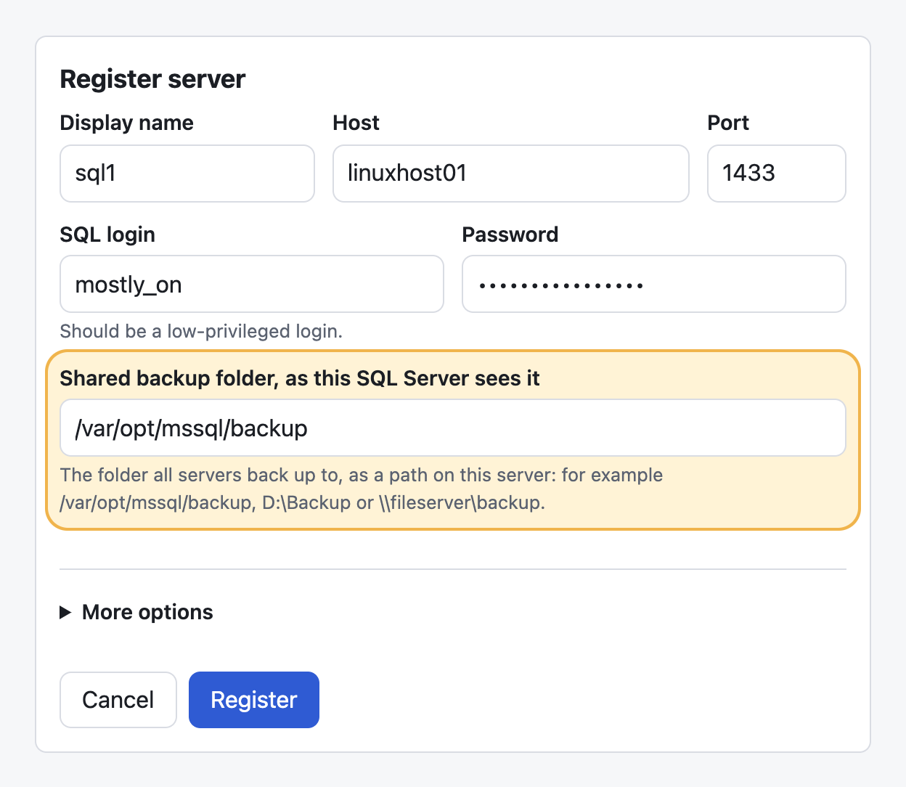

# SQL Server containers on Linux

**IMPORTANT** These instructions are for SQL Server running in a container (using Microsoft's `mcr.microsoft.com/mssql/server` image) on a Linux host.

Repeat these steps on each SQL Server host.

Before you start:

- Mostly-On is running, and the backup share is ready ([Setting up the Mostly-On container](mostly-on-container.md), steps 1 to 6).
- Docker is installed on this machine and starts when it boots ([step 2](mostly-on-container.md#2-install-docker-on-this-machine) of that guide).
- **NFS:** this machine is in the share's export list on the NFS server (`sql1(rw,sync)` in `/etc/exports`, then `sudo exportfs -ra`).

SQL Server in the container runs as user 10001, the same as Mostly-On, so the share needs no special treatment.

## 1. Mount the share on this machine

The SQL Server container only sees the folders you hand it. So you mount the share on this machine first, at `/mnt/sqlbackup`, and hand it to the container in step 2.

- [ ] Create the folder to mount the share on, and lock it while it's empty. If the share ever fails to mount, backups then fail loudly instead of quietly landing on the local disk:

  ```sh
  sudo mkdir -p /mnt/sqlbackup
  sudo chattr +i /mnt/sqlbackup
  ```

- [ ] **NFS:** add this line to `/etc/fstab`, so the share is mounted at every start. `nofail` lets the machine start even when the share can't be reached:

  ```
  nfs-server:/srv/sqlbackup  /mnt/sqlbackup  nfs  rw,nfsvers=4.1,_netdev,nofail  0  0
  ```

- [ ] **SMB:** install the SMB client, and store the share's account in a file that only root can read:

  ```sh
  sudo apt install cifs-utils        # or: sudo dnf install cifs-utils
  sudo install -m 600 /dev/null /etc/sqlbackup.cred
  sudo nano /etc/sqlbackup.cred
  ```

  with these lines. Leave out `domain=` unless it's a domain account (an account on a NAS or a storage service usually isn't):

  ```
  username=sqlbackup
  password=...
  domain=EXAMPLE
  ```

  Then add this line to `/etc/fstab`. `uid=10001,gid=0` makes the files appear owned by the user SQL Server runs as, and `nofail` lets the machine start even when the share can't be reached.

  ```
  //fileserver/sqlbackup  /mnt/sqlbackup  cifs  credentials=/etc/sqlbackup.cred,uid=10001,gid=0,file_mode=0660,dir_mode=0770,vers=3.0,_netdev,nofail  0  0
  ```

  Add `seal` to the options to encrypt traffic, and always do so when the share is reached over the internet. If the file server supports SMB 3.1.1 (Windows Server 2016 or newer, and most current NAS), use `vers=3.1.1`.

- [ ] Mount it, and check that user 10001 can write and delete there. `daemon-reload` makes the system read the changed `/etc/fstab`:

  ```sh
  sudo systemctl daemon-reload
  sudo mount /mnt/sqlbackup
  docker run --rm -u 10001:0 -v /mnt/sqlbackup:/b busybox:1.37 sh -c 'touch /b/.test && rm /b/.test && echo OK'
  ```

## 2. Hand the share to the SQL Server container

- [ ] In the SQL Server container's compose file, add the share under `volumes`, at `/var/opt/mssql/backup`. A complete example:

  ```yaml
  services:
    sql:
      image: mcr.microsoft.com/mssql/server:2025-latest
      hostname: sql1
      restart: unless-stopped
      environment:
        ACCEPT_EULA: "Y"
        MSSQL_PID: Express
        MSSQL_SA_PASSWORD: ${MSSQL_SA_PASSWORD}
      ports: ["1433:1433"]
      volumes:
        - sql-data:/var/opt/mssql
        - type: bind
          source: /mnt/sqlbackup
          target: /var/opt/mssql/backup
          bind:
            propagation: rslave

  volumes:
    sql-data:
  ```

  Give it a fixed `hostname`: otherwise SQL Server's name changes every time the container is recreated.

  Docker doesn't wait for the share when the machine starts, so SQL Server can start before the share is mounted, and its backups then fail on the locked folder. `propagation: rslave` makes the share show up inside the container once it's mounted, without a restart. If the share couldn't be reached when the machine started, mount it with `sudo mount /mnt/sqlbackup` once it's back.

- [ ] Start or restart it, and check that SQL Server can write to the share:

  ```sh
  docker compose up -d
  docker compose exec sql sh -c 'touch /var/opt/mssql/backup/.test && rm /var/opt/mssql/backup/.test && echo OK'
  ```

## 3. Let Mostly-On connect

- [ ] Allow TCP 1433 from the Mostly-On machine in this machine's firewall.
- [ ] Create a login for Mostly-On. Connect as `sa` (SSMS, or `sqlcmd`) and run:

  ```sql
  CREATE LOGIN mostly_on WITH PASSWORD = N'…', CHECK_EXPIRATION = OFF;
  ```

  Give it no other permissions. This is intended as a low-privilege account,
  and the setup script in step 4 will grant the specific permissions it needs.

## 4. Register the server and run its setup script

- [ ] In Mostly-On, on the **Servers** page, press **Register server**:

  | Field | Value |
  |---|---|
  | Display name | A short name, such as `sql1`. It ends up in backup file names. |
  | Host / Port | This machine's name or IP address, and `1433`. |
  | SQL login / Password | `mostly_on` and its password. |
  | Shared backup folder, as this SQL Server sees it | `/var/opt/mssql/backup` |

  

- [ ] Download the server's setup script. Mostly-On offers it right after you register the server, or later on the server's page, under **Setup**. It has the server's backup folder and login filled in.
- [ ] Run the script on the server as `sa` (or another sysadmin). Running it again is always safe.
- [ ] Within a minute, the server's page shows **ready**.

Why the script, and what it allows: [The setup script](../README.md#the-setup-script-and-why-mostly-on-does-not-need-sysadmin).
