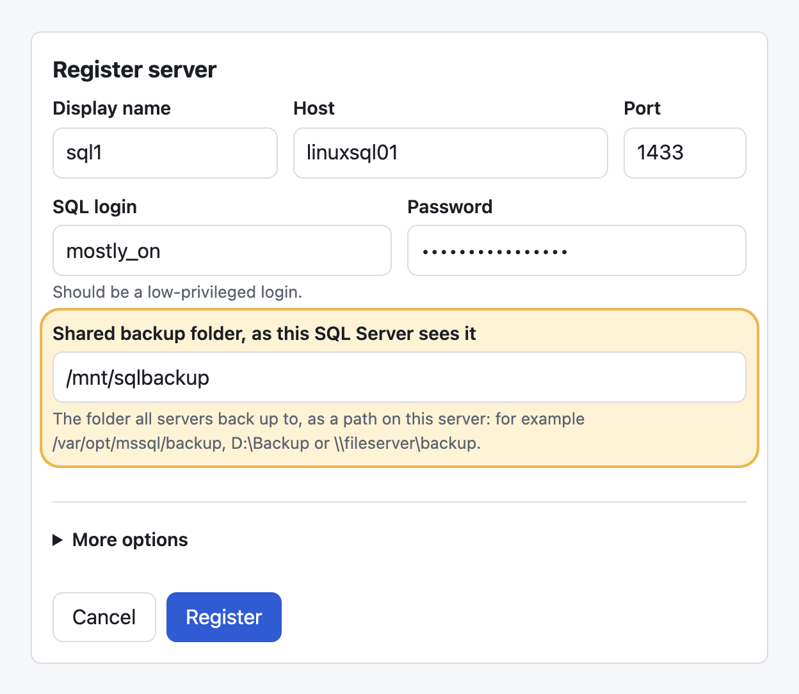

# SQL Server on Linux

**IMPORTANT** These instructions are for SQL Server installed on a Linux machine from Microsoft's packages (`mssql-server`), not running in a container.

Repeat these steps on each SQL Server.

Before you start: Mostly-On is running, and the backup share is ready ([Setting up the Mostly-On container](mostly-on-container.md), steps 1 to 6).

SQL Server runs as the `mssql` user, whose user ID differs from machine to machine. Mostly-On runs as user 10001. Both must be able to read, write and delete each other's files on the share. With SMB, the mount options take care of that; with NFS, the export options do.

## 1. Mount the share on this machine

SQL Server uses the share directly, at `/mnt/sqlbackup`.

- [ ] Create the folder to mount the share on, and lock it while it's empty. If the share ever fails to mount, backups then fail loudly instead of quietly landing on the local disk:

  ```sh
  sudo mkdir -p /mnt/sqlbackup
  sudo chattr +i /mnt/sqlbackup
  ```

- [ ] **NFS:** on the NFS server, add this machine to the export, with options that store everything it writes as user 10001 (`all_squash`), whatever user ID it claims. In `/etc/exports`, then run `sudo exportfs -ra`:

  ```
  /srv/sqlbackup  mostly-on-host(rw,sync) sql1(rw,sync,all_squash,anonuid=10001,anongid=0)
  ```

  Then, on this machine, add this line to `/etc/fstab`:

  ```
  nfs-server:/srv/sqlbackup  /mnt/sqlbackup  nfs  rw,nfsvers=4.1,_netdev  0  0
  ```

- [ ] **SMB:** install the SMB client, and store the share's account in a file that only root can read:

  ```sh
  sudo apt install cifs-utils        # or: sudo dnf install cifs-utils
  sudo install -m 600 /dev/null /etc/sqlbackup.cred
  sudo nano /etc/sqlbackup.cred
  ```

  with these three lines:

  ```
  username=sqlbackup
  password=...
  domain=EXAMPLE
  ```

  Then add this line to `/etc/fstab`. `uid=mssql,gid=mssql` makes the files appear owned by the user SQL Server runs as. Add `seal` to the options to encrypt traffic.

  ```
  //fileserver/sqlbackup  /mnt/sqlbackup  cifs  credentials=/etc/sqlbackup.cred,uid=mssql,gid=mssql,file_mode=0660,dir_mode=0770,vers=3.0,_netdev  0  0
  ```

- [ ] Mount it, and check that SQL Server's user can write and delete there:

  ```sh
  sudo mount /mnt/sqlbackup
  sudo -u mssql sh -c 'touch /mnt/sqlbackup/.test && rm /mnt/sqlbackup/.test && echo OK'
  ```

## 2. Let Mostly-On connect

- [ ] Allow TCP 1433 from the Mostly-On machine in this machine's firewall.
- [ ] Create a login for Mostly-On. Connect as `sa` (SSMS, or `sqlcmd -S localhost -U sa`) and run:

  ```sql
  CREATE LOGIN mostly_on WITH PASSWORD = N'…', CHECK_EXPIRATION = OFF;
  ```

  Give it no other permissions. This is intended as a low-privilege account,
  and the setup script in step 4 will grant the specific permissions it needs.

## 3. Register the server and run its setup script

- [ ] In Mostly-On, on the **Servers** page, press **Register server**:

  | Field | Value |
  |---|---|
  | Display name | A short name, such as `sql1`. It ends up in backup file names. |
  | Host / Port | This machine's name or IP address, and `1433`. |
  | SQL login / Password | `mostly_on` and its password. |
  | Shared backup folder, as this SQL Server sees it | `/mnt/sqlbackup` |

  

- [ ] Download the server's setup script. Mostly-On offers it right after you register the server, or later on the server's page, under **Setup**. It has the server's backup folder and login filled in.
- [ ] Run the script on the server as `sa` (or another sysadmin). Running it again is always safe.
- [ ] Within a minute, the server's page shows **ready**.

Why the script, and what it allows: [The setup script](../README.md#the-setup-script-and-why-mostly-on-does-not-need-sysadmin).

## NFS without `all_squash`

If you'd rather keep real user IDs on the share, use a shared group instead:

- [ ] Create a group with the same group ID on every machine, and add `mssql` to it (`sudo usermod -aG <group> mssql`, then `sudo systemctl restart mssql-server`).
- [ ] Run Mostly-On with that group: `user: "10001:<gid>"` under its service in `docker-compose.yml`.
- [ ] On the NFS server, give the folder to that group (`sudo chgrp <gid> /srv/sqlbackup`, `sudo chmod 2770 /srv/sqlbackup`), and export it without `all_squash`.
- [ ] If restores on another machine fail with *Operating system error 5*, the backup files aren't readable by the group. Add a default ACL on the NFS server: `sudo setfacl -d -m g::rwX /srv/sqlbackup`.
